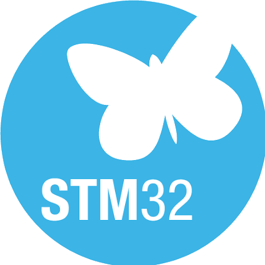
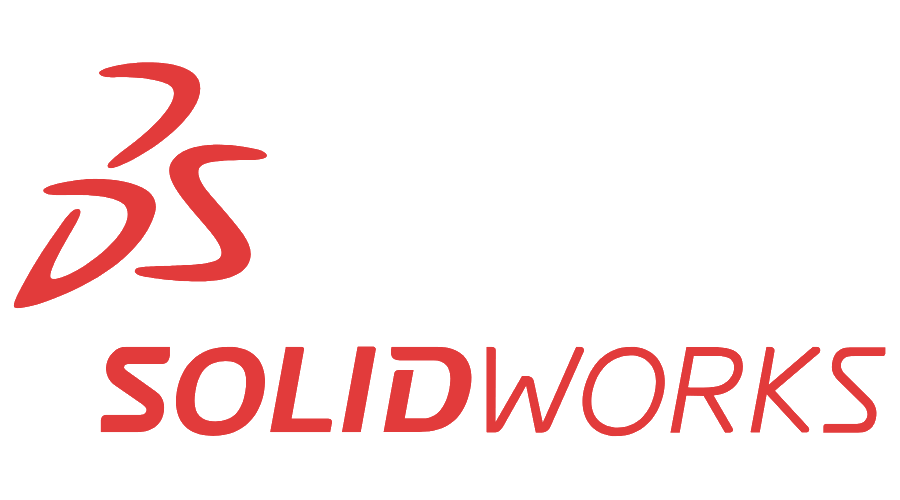

<h1 data-importer="welcom" align="center">Welcome Comrades</h1>

###
<!-- 

  
<b> Hardware Designer & Firmware Developer </b>

 
-->

<!-- > ❝Never compromise. Not even in the face of Armageddon❞ -->

###

  
  

###

# Operator Profile

###

<b>Hardware Designer and Embedded Software Developer, passionate about CAD modeling and software development. Fascinated by anything that flies, from RC aircraft and FPV drones to full-scale aircraft. In my free time, I enjoy solving problems <a href="https://www.codewars.com/users/gorramin">@Codewars</a>, going fishing and doing pull-ups.

###

<h3 data-importer="text" align="left">Technical Arsenal</h3>

###

  
  
  
  
  
  
  
  
  
  
   
  
  
  
  
  
  
  
  
   
  
  
  
  
  
  
   
  
  
  
  
  
  
  

###

# Active Missions

###

- Developing [Signal Generator](https://github.com/gorramin/signal-generator) — 4-channel signal generator for industrial applications, supporting 0–10 V, 4–20 mA, and
PWM signals, based on an Arduino Nano with an OLED display.

- Developing [KiCad Documentation Generator](https://github.com/gorramin/kicad-documentation-generator) — an automated tool to generate project documentation from KiCad projects, integrating CI/CD to streamline and automate the documentation workflow.

